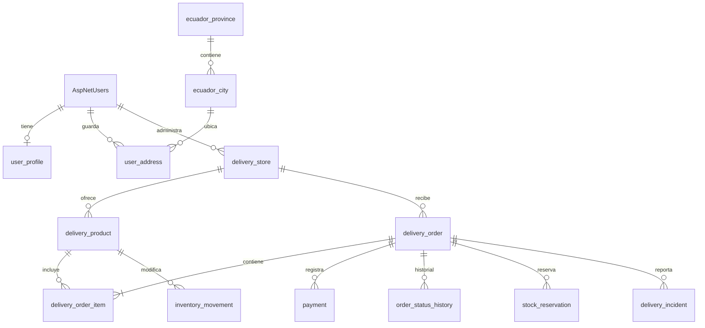
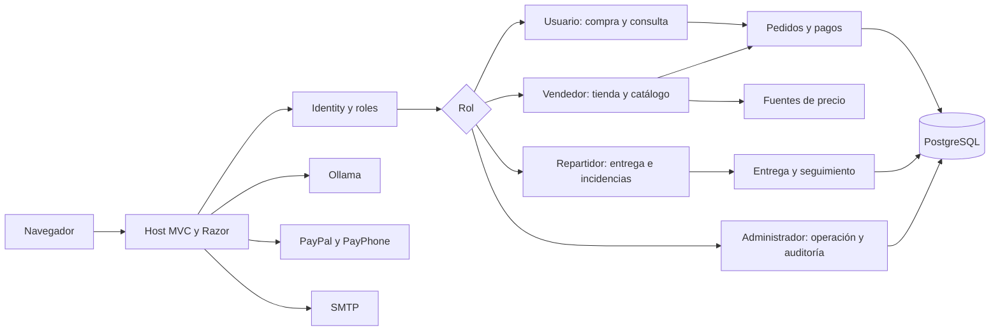

# Orbi App

Plataforma web de comercio y entregas para Ecuador. Administra tiendas, productos, pedidos, pagos, inventario, entregas, incidencias, auditoría y asistencia con IA. La interfaz usa ASP.NET Core MVC, Razor Pages, JavaScript y CSS; PostgreSQL almacena los datos.

## Tabla de contenido

1. [Requisitos y configuración local](#1-requisitos-y-configuración-local)
2. [Arquitectura y proyectos](#2-arquitectura-y-proyectos)
3. [Configuración e integraciones](#3-configuración-e-integraciones)
4. [Usuarios de prueba y funciones por rol](#4-usuarios-de-prueba-y-funciones-por-rol)
5. [Base de datos y datos de demostración](#5-base-de-datos-y-datos-de-demostración)
6. [Desarrollo y compilación](#6-desarrollo-y-compilación)
7. [Generación masiva de datos](#7-generación-masiva-de-datos)
8. [Backups y restauración](#8-backups-y-restauración)
9. [Docker Compose](#9-docker-compose)

## 1. Requisitos y configuración local

### Requisitos

- Windows, Linux o macOS con el SDK de .NET 10 instalado.
- PostgreSQL accesible con una base de datos vacía, o Docker Desktop.
- Ollama es opcional; solo se necesita para las funciones de IA.
- Las credenciales de Google, PayPal, PayPhone y SMTP son opcionales para las partes de la aplicación que las usan.

El SDK se puede instalar desde la [guía oficial para Windows](https://learn.microsoft.com/dotnet/core/install/windows). Comprueba la instalación con:

```powershell
dotnet --list-sdks
dotnet --version
```

### Puesta en marcha local

Desde la raíz del repositorio, inicia PostgreSQL con Docker Compose:

```powershell
docker compose up -d postgres
```

Compose usa los secretos locales `.docker/secrets/postgres_password` (administración) y `.docker/secrets/orbi_app_password` (aplicación). Se mantienen fuera del control de versiones. La cuenta `orbi_app` es la que debe usar la aplicación; la cuenta configurada en `POSTGRES_USER` queda reservada para tareas administrativas. PostgreSQL solo aplica scripts de inicialización cuando el volumen está vacío. Si ya tienes datos, ejecuta una vez `docker compose exec -T postgres sh /docker-entrypoint-initdb.d/003_create_app_role.sh` con las credenciales administrativas vigentes. Cambiar el archivo secreto no rota automáticamente la contraseña guardada dentro de un volumen existente.

Para crear los secretos una sola vez si todavía no existen, genera valores aleatorios locales:

```powershell
New-Item -ItemType Directory .\.docker\secrets -Force | Out-Null
foreach ($name in @('postgres_password', 'orbi_app_password')) {
    $path = Join-Path .\.docker\secrets $name
    if (-not (Test-Path $path)) {
        $bytes = [System.Security.Cryptography.RandomNumberGenerator]::GetBytes(32)
        [System.IO.File]::WriteAllText($path, [Convert]::ToHexString($bytes))
        [Array]::Clear($bytes, 0, $bytes.Length)
    }
}
```

Configura la cadena de conexión con el secreto local de la cuenta de aplicación:

```powershell
$dbPassword = (Get-Content .\.docker\secrets\orbi_app_password -Raw).Trim()
$env:ConnectionStrings__DefaultConnection = "Host=localhost;Port=5433;Database=orbi_app;Username=orbi_app;Password=$dbPassword"
Remove-Variable dbPassword
dotnet restore .\src\Core\Presentation\Presentation.csproj
dotnet run --project .\src\Core\Presentation\Presentation.csproj
```

La aplicación prepara Identity, ejecuta `orbi-schema.sql` y `orbi-locations.sql`, crea los usuarios de demostración y carga `orbi-data.sql` si está presente. Usa una base de desarrollo: el seeder y los scripts iniciales están diseñados para preparar el entorno de demostración.

Para guardar configuración local en User Secrets:

```powershell
Puedes guardar esa misma cadena en User Secrets para no cargarla manualmente en cada sesión. No escribas el valor de la contraseña en archivos versionados ni en comandos guardados en el historial.
```

## 2. Arquitectura y proyectos

La aplicación separa el modelo y las reglas de negocio de los adaptadores web, los proveedores externos y la persistencia. Las dependencias del núcleo apuntan hacia adentro: infraestructura implementa los puertos que define Application, y el host web conecta los componentes al iniciar.

```text
Navegador
   │ HTTP / Razor Pages
   ▼
OrbiApp (host y adaptadores MVC) ──────► OrbiApp.Application ──────► OrbiApp.Domain
   │                                            ▲
   └────────────────► OrbiApp.Infrastructure ──┘
                       ├── PostgreSQL / EF Core
                       ├── Ollama
                       ├── PayPal y PayPhone
                       ├── precios de comercios
                       ├── correo SMTP
                       └── backups
```

El código se agrupa primero por funcionalidad en `src/Features/<Feature>` y dentro de cada feature se ubican las capas que necesita (`Domain`, `Application`, `Infrastructure` y `Presentation`). `src/Core` reúne los proyectos compartidos de Dominio y Aplicación, junto con los proyectos globales de Infraestructura y Presentación. Las capas siguen respetando la dirección de dependencias hexagonal.

Los controladores usan el puerto compartido `IApplicationDataSession`; su adaptador EF Core y `EfEntitySet<T>` están en Infrastructure. Los servicios de IA, pagos, respaldos y precios externos se agrupan bajo sus features y exponen sus contratos desde Application.

`src/Program.cs` es el punto de entrada y composición del backend: registra adaptadores, configura Identity y middleware, y llama al inicializador de base de datos. `src/Core/Presentation/Presentation.csproj` lo incluye como archivo enlazado. La persistencia transversal reside en `Features/Shared/Infrastructure`; la inicialización de Identity está dentro de `Features/Identity`.

### Proyectos

| Proyecto | Responsabilidad |
|---|---|
| `src/Core` | Proyectos de compilación de Dominio y Aplicación y contratos compartidos de persistencia. Compilan los archivos de sus capas dentro de `Features`. |
| `src/Features/<Feature>` | Código vertical por funcionalidad y por capa, por ejemplo `Delivery/{Domain,Application,Infrastructure,Presentation}` y `Payments/{Application,Infrastructure}`. |
| `src/Core/Infrastructure` | Proyecto y registro de dependencias de infraestructura. La implementación se organiza en las capas `Infrastructure` de cada feature. |
| `src/Core/Presentation` | Proyecto host, configuración común de MVC, vistas compartidas y recursos web comunes. Los controladores y vistas específicos están en cada feature. |
| `tools/OrbiApp.DataGenerator` | Herramienta independiente para generar datos de negocio. |

Ejemplos: `Features/Delivery` contiene sus capas de dominio, aplicación, infraestructura y presentación; `Features/Payments` agrupa contratos, opciones y adaptadores de PayPal y PayPhone; `Features/Operations` concentra modelos, puertos y adaptadores operativos. Los contratos genéricos de persistencia permanecen en `Core`.

### Tecnologías

- .NET 10, ASP.NET Core MVC, Razor Pages y C# 14 (predeterminado con el SDK de .NET 10).
- Entity Framework Core 10, ASP.NET Core Identity y Npgsql 10.
- PostgreSQL 16 mediante Docker Compose.
- MailKit para SMTP; Ollama para el asistente; PayPal Sandbox y PayPhone para pagos.
- Docker Compose y Mermaid.

Los paquetes de EF Core, Npgsql y MailKit están en `OrbiApp.Infrastructure`. El host web conserva las dependencias de presentación, Identity UI, autenticación Google y scaffolding MVC.

## 3. Configuración e integraciones

### Configuración general

ASP.NET Core admite `appsettings.json`, User Secrets y variables de entorno. En las variables de entorno se reemplazan los dos puntos por doble guion bajo (`:` → `__`). Valores más usados:

| Clave | Uso |
|---|---|
| `ConnectionStrings:DefaultConnection` | Conexión PostgreSQL compartida por los contextos. |
| `Ollama:BaseUrl`, `Ollama:Model` | URL y modelo del servicio de IA. |
| `PayPal:ClientId`, `PayPal:ClientSecret`, `PayPal:BaseUrl` | Credenciales y API de PayPal; sus opciones tipadas están en la feature `Payments` de Infrastructure. |
| `PayPhone:Token`, `PayPhone:StoreId` | Credenciales de PayPhone. |
| `Authentication:Google:ClientId`, `Authentication:Google:ClientSecret` | Inicio de sesión con Google. |
| `EmailSettings:*` | Servidor SMTP y cuenta remitente. |
| `DataProtection:KeysPath` | Persistencia de claves de autenticación. |
| `BACKUP_DIR`, `BACKUP_INTERVAL_MINUTES`, `BACKUP_RETENTION_COUNT` | Directorio, intervalo y retención de respaldos. |

### PayPal

La integración usa PayPal Sandbox. Configura `PayPal:ClientId`, `PayPal:ClientSecret`, `PayPal:BaseUrl`, `PayPal:ReturnUrl`, `PayPal:CancelUrl` y `PayPal:CurrencyCode`. El backend crea una orden, devuelve la URL de aprobación y captura la orden al recibir el retorno.

### PayPhone

Configura `PayPhone:Token` y `PayPhone:StoreId`. `PayPhoneApiLinkService` crea enlaces de pago en USD. Nunca guardes credenciales reales en el repositorio.

### Google y correo

Google Identity necesita `Authentication:Google:ClientId` y `Authentication:Google:ClientSecret`. El correo usa Gmail SMTP con `EmailSettings:SmtpServer`, `EmailSettings:SmtpPort`, `EmailSettings:SenderEmail`, `EmailSettings:SenderName` y `EmailSettings:Password`. `EmailQueueWorker` procesa los mensajes pendientes; proporciona claves mediante User Secrets o variables de entorno.

### Ollama y comparación de precios

Ollama se configura con `Ollama:BaseUrl` y `Ollama:Model`; el valor inicial del modelo es `qwen2.5:0.5b`. El host de Ollama debe ser accesible desde el proceso de la aplicación. `ExternalMarketPriceService` consulta comercios ecuatorianos para calcular un rango y precio de referencia. Estas integraciones son opcionales para iniciar la aplicación, aunque sus funciones requieren que el servicio remoto esté disponible.

## 4. Usuarios de prueba y funciones por rol

`IdentitySeeder` crea estos usuarios cuando aún no existen, les confirma el correo y asigna sus roles. Las credenciales indicadas son las iniciales del seeder; si el usuario ya existe, el seeder conserva su contraseña actual y actualiza el rol y perfil.

| Nombre | Rol | Correo | Contraseña inicial |
|---|---|---|---|
| Jefferson Mejía | Administrador | `jefferson.mejia@orbi.com` | `Admin123*` |
| María López | Vendedor | `maria.lopez@orbi.com` | `Vendedor123*` |
| Carlos Pérez | Repartidor | `carlos.perez@orbi.com` | `Reparto123*` |
| Ana Torres | Usuario | `ana.torres@orbi.com` | `Usuario123*` |

### Perfiles de demostración

- **Jefferson Mejía:** administrador; cédula `0912345675`, domicilio en Guayaquil (Guayas), referencia «Frente al parque».
- **María López:** vendedora; cédula `1712345671`, domicilio en Quito (Pichincha), administra Farmacia Cruz Azul.
- **Carlos Pérez:** repartidor; cédula `0923456784`, domicilio en Durán (Guayas), tiene asignadas entregas e incidencias de demostración.
- **Ana Torres:** usuaria; cédula `0123456782`, domicilio en Cuenca (Azuay), tiene pedidos de farmacia de demostración.

Los ejemplos corresponden a cuentas de desarrollo. Cambia o elimina estas credenciales antes de publicar un entorno accesible al público. El seeder está en `src/Features/Identity/Infrastructure/Persistence/IdentitySeeder.cs`.

### Funciones por rol

| Rol | Funciones principales |
|---|---|
| Usuario | Explora tiendas y productos, administra direcciones, compra y consulta pedidos y pagos. |
| Vendedor | Administra su tienda y catálogo, revisa pedidos y recibe sugerencias de precio. |
| Repartidor | Consulta entregas asignadas, actualiza estados y reporta incidencias. |
| Administrador | Supervisa usuarios, tiendas, pedidos, pagos, inventario, auditoría, correo e incidencias. |

Identity permite activar MFA con aplicaciones compatibles con TOTP, como Google Authenticator. La cuenta puede vincular la aplicación mediante un código QR, guardar códigos de recuperación y administrar la verificación en dos pasos desde Seguridad.

## 5. Base de datos y datos de demostración

`ApplicationDbContext` administra Identity y las tablas de comercio, entrega, perfiles, ubicaciones y operaciones mediante PostgreSQL, configurado en `ConnectionStrings:DefaultConnection`.

Las migraciones y contextos compartidos están en `src/Features/Shared/Infrastructure/Persistence`; los scripts versionados, en `src/Features/Shared/Infrastructure/Sql`:

- `orbi-schema.sql`: esquema de tienda, entrega, pagos, inventario y operaciones.
- `orbi-locations.sql`: provincias y cantones de Ecuador.
- `orbi-data.sql`: catálogo inicial de demostración, cuando se incluye.
- `assign-store-owners.sql`, `seed-monthly-province-sales.sql` y `validate-generated-data.sql`: administración y verificación de datos.

El seeder de Identity mantiene cuatro roles y perfiles de acceso; crea una tienda de farmacia, ocho productos y relaciones de pedidos, pagos, inventario e incidencias para que cada rol pueda revisar el flujo de demostración. La inicialización se puede repetir: busca los registros sembrados antes de agregarlos.

### Entidades principales



### Flujo principal



## 6. Desarrollo y compilación

Restaura y compila toda la solución, incluidos el host y el generador:

```powershell
dotnet restore .\OrbiApp.slnx
dotnet build .\OrbiApp.slnx
```

Los proyectos de dominio, aplicación e infraestructura se compilan como referencias del host. El generador de datos es independiente y se restaura/compila con `dotnet build .\src\OrbiApp.DataGenerator\OrbiApp.DataGenerator.csproj`.

Para añadir una integración externa, define el puerto en `Features/<Feature>/Application` e implementa el adaptador en `Features/<Feature>/Infrastructure`; registra la implementación desde `src/Core/Infrastructure`. Para contratos genéricos que usan varias funcionalidades, utiliza `src/Core/Application/Ports`.

## 7. Generación masiva de datos

`OrbiApp.DataGenerator` produce un conjunto reproducible con Bogus y Npgsql. La configuración predeterminada genera un millón de filas en lotes de 5.000, con semilla 2026. Ejecuta el generador desde la raíz:

```powershell
$dbPassword = (Get-Content .\.docker\secrets\orbi_app_password -Raw).Trim()
$env:ConnectionStrings__DefaultConnection = "Host=localhost;Port=5433;Database=orbi_app;Username=orbi_app;Password=$dbPassword"
Remove-Variable dbPassword
dotnet run --project tools/OrbiApp.DataGenerator -- --records 1000000 --batch-size 5000 --seed 2026 --locale es --reference-date 2026-07-01T00:00:00Z
```

Por seguridad, el generador se detiene si encuentra datos de negocio existentes. `--reset` permite reiniciarlos antes de cargar, así que úsalo solo en una base descartable:

```powershell
dotnet run --project tools/OrbiApp.DataGenerator -- --records 1000000 --batch-size 5000 --seed 2026 --locale es --reference-date 2026-07-01T00:00:00Z --reset
```

`tools/OrbiApp.DataGenerator/README.md` describe las opciones, variables de entorno, validaciones y distribución de registros.

## 8. Backups y restauración

`BackupService` ejecuta `pg_dump` en segundo plano. Configura `BACKUP_DIR`, `BACKUP_INTERVAL_MINUTES` y `BACKUP_RETENTION_COUNT`; en contenedores, monta el directorio de respaldos del host y define ahí `BACKUP_DIR`.

Lista los respaldos en PowerShell:

```powershell
Get-ChildItem -LiteralPath .\backups -Filter orbi_backup_*.sql -File |
  Sort-Object LastWriteTimeUtc -Descending
```

La restauración administrativa conserva un respaldo previo e intenta restaurarlo si la importación falla. Verifica el archivo de respaldo y el destino antes de restaurar.

## 9. Docker Compose

`docker-compose.yml` inicia PostgreSQL 16, publica el puerto `5433` solo en localhost y monta el esquema y los datos iniciales para una base nueva. Compose se usa aquí para la base de datos; la aplicación se ejecuta localmente con `dotnet run` siguiendo la sección «Puesta en marcha local».
